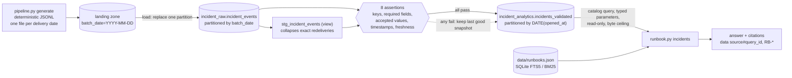

# GCP DataOps Runbook Assistant

A portfolio project that builds and operates a small, reliable incident-data
pipeline on BigQuery and uses the validated data to answer incident questions
with cited runbooks.

- **Ingestion.** A deterministic generator produces synthetic incident events.
  Loads are idempotent per partition, late events are absorbed, and any date
  range can be replayed.
- **Transformation and quality.** Dataform (BigQuery) builds a validated
  incident table. Eight assertions guard keys, required fields, accepted values,
  timestamps and freshness.
- **Assistant.** A read-only, parameterized query over the validated table is
  combined with offline runbook retrieval. Answers cite the data source and the
  runbook ID, and the assistant abstains when evidence is missing.
- **Infrastructure and CI.** Terraform defines the GCP resources with official
  `terraform-google-modules` registry modules. GitHub Actions runs the Python
  tests, validates and plans Terraform, and compiles Dataform without GCP
  credentials.

All incidents, services and runbooks are fictional. The repository holds no
credentials, Terraform state or customer data. Text, examples and answers use
US English (en-US).

## Architecture



The same contracts run in two modes:

| Layer | Local mode (no credentials) | GCP mode |
| --- | --- | --- |
| Raw table | SQLite `raw_incident_events` | BigQuery `incident_raw.incident_events` |
| Idempotent load | `DELETE` + `INSERT` per `batch_date` in one transaction | Load job to `incident_events$YYYYMMDD` with `WRITE_TRUNCATE` |
| Staging and checks | SQL in `dataops/local_warehouse.py` | Dataform `dataform/definitions/` |
| Validated table | Rebuilt only if all checks pass | `incidents_validated` depends on every assertion |
| Assistant query | SQLite opened with `mode=ro` | Viewer-only service account, `maximum_bytes_billed` |

### Repository layout

```text
runbook.py                 Original CLI: ask, evaluate; new: incidents
pipeline.py                generate, load, transform, check, run, reprocess, status, demo
dataops/events.py          Generator, schema helpers, fault injection
dataops/local_warehouse.py SQLite stand-in for raw, staging, checks, validated
dataops/bigquery_backend.py BigQuery loads and read-only queries
dataops/incident_query.py  Question parsing, query catalog, cited answers
schema/incident_events.json Raw schema shared by Python and Terraform
dataform/                  Dataform project (declarations, staging, assertions, marts)
infra/                     Terraform (registry modules) for APIs, datasets, raw table, service accounts, IAM
data/runbooks.json         Six fictional runbooks
data/samples/              Batch with intentional faults
docs/operations.md         Diagnose failures and reprocess batches
```

## Event schema

One row is one lifecycle change of one incident. The source of truth is
[schema/incident_events.json](schema/incident_events.json), which Terraform uses
to create the BigQuery table.

| Field | Type | Notes |
| --- | --- | --- |
| `event_id` | STRING | Stable key: `evt-` + 16 hex chars of `sha256(incident_id:sequence)` |
| `incident_id` | STRING | Stable key: `INC-YYYYMMDD-NNN` (open date and number) |
| `sequence` | INTEGER | Lifecycle step, starting at 1 |
| `service` | STRING | `checkout`, `edge-gateway`, `orders-db`, `order-queue`, `ci-platform`, `cluster-dns` |
| `severity` | STRING | `critical`, `high`, `medium`, `low` |
| `status` | STRING | `open`, `acknowledged`, `mitigated`, `resolved` |
| `summary` | STRING | Synthetic symptom text, used to find a runbook |
| `event_ts` | TIMESTAMP | When the change happened (UTC) |
| `batch_date` | DATE | Delivery date of the batch; partition column |
| `ingested_at` | TIMESTAMP | When the loader wrote the batch |

The payload columns are `NULLABLE` on purpose. A bad record lands in the raw
table, where an assertion reports it with its `batch_date`, instead of failing
the whole load with a less specific error.

The generator derives every value from `(seed, date)`. About 15% of events
arrive one or two days late, and incidents can cross midnight, so a batch can
carry events from earlier days. `incidents_validated` holds one row per incident
with its latest status, lifecycle timestamps, `event_count` and
`last_batch_date`.

## Local mode

Requires Python 3.11+ with SQLite FTS5 (included in standard Python builds). No
packages, credentials or network access are needed.

### Original runbook assistant

```bash
python3 runbook.py ask "Checkout restarting with OOMKilled"
python3 runbook.py ask "Ingress responding with 502 after rollout"
python3 runbook.py evaluate
```

### Full pipeline scenario

```bash
python3 pipeline.py demo
python3 runbook.py incidents --as-of 2026-11-17T06:00:00Z
python3 -m unittest discover -s tests -v
```

`pipeline.py demo` rebuilds `.warehouse/demo/` from fixed dates
(2026-11-03 to 2026-11-16). It runs the five steps below and prints a JSON
report that ends with `"passed": true`. The exit code is 1 if any expectation
fails.

### Step by step

```bash
# Generate and load 14 daily batches, then run checks and build the validated table.
python3 pipeline.py run --start 2026-11-03 --end 2026-11-16 --as-of 2026-11-17T06:00:00Z

# Ask the demo question against that warehouse.
python3 runbook.py incidents --db .warehouse/incidents.db --as-of 2026-11-17T06:00:00Z

# Overwrite one partition with the intentional-fault sample, then validate.
python3 pipeline.py load --file data/samples/faulty_batch_2026-11-16.jsonl --batch-date 2026-11-16
python3 pipeline.py transform --as-of 2026-11-17T06:00:00Z          # exit code 1

# Replay the partition from clean source data.
python3 pipeline.py reprocess --start 2026-11-16 --end 2026-11-16 --as-of 2026-11-17T06:00:00Z
python3 pipeline.py status
```

Without `--start` and `--end`, `run` and `reprocess` use the 14 days ending
yesterday (UTC). Without `--as-of`, checks and questions use the current time.

## Expected behavior

### 1. Normal run

All eight checks pass, and `incidents_validated` is rebuilt. Loading the same
batch again replaces its partition: the raw row count and the validated count
stay the same (241 raw rows and 68 incidents after 2026-11-15 in the demo).
When the 2026-11-16 batch arrives, it carries late events. For example,
`evt-1933e0953ee4b55c` is the `mitigated` event (sequence 3) of
`INC-20261114-005`. It happened at 2026-11-15T02:17:35Z but was delivered on
2026-11-16, one day after the `resolved` event (sequence 4). After the run, the
incident has `event_count` 4 instead of 3 and a `mitigated_at` time. Its status
stays `resolved`, because the latest state is chosen by `sequence`, not by
arrival order.

The assistant then answers the demo question:

```text
$ python3 runbook.py incidents --as-of 2026-11-17T06:00:00Z
question (default): Which service had the most critical incidents in the last
seven days and which runbook should I check?

answer: checkout had the most critical incidents opened between 2026-11-10T06:00:00Z and
2026-11-17T06:00:00Z. checkout: 2 critical incident(s) (INC-20261111-002,
INC-20261116-002); most common symptom "checkout deployment in CrashLoopBackOff
after release". Consult RB-K8S-01 (Checkout deployment enters CrashLoopBackOff):
Check the failing revision, pod events, previous container logs and the last
termination reason. Data source: local:incidents_validated#top_services_by_severity_v1.

citations: ["local:incidents_validated#top_services_by_severity_v1", "RB-K8S-01"]
```

The JSON output also includes `evidence`: the query ID, its typed parameters,
counts per service, the incident IDs, and the snapshot time.

### 2. Quality failure

[data/samples/faulty_batch_2026-11-16.jsonl](data/samples/faulty_batch_2026-11-16.jsonl)
is the 2026-11-16 batch with six injected defects. `pipeline.py generate
--inject-faults` reproduces it, and a test checks that the file matches.

| Injected defect | Check that fails |
| --- | --- |
| Event copy without `event_id` | `assert_event_id_not_null` |
| Same `event_id` with a different `status` | `assert_event_id_unique` |
| `service` is null | `assert_required_fields_not_null` |
| `severity = "urgent"` | `assert_valid_severity` |
| `event_ts` 30 days in the future | `assert_event_ts_not_future` |
| One event of an incident moved to another service | `assert_incident_single_service` |

`transform` exits with code 1 and lists the failed checks with sample rows.
`validated_table_updated` is `false`, and `incidents_validated` keeps the last
good snapshot. If someone asks a question at this point, the assistant still
answers from that snapshot but adds the warning `Latest quality run failed`. In
Dataform, the failed assertions make the CLI skip `incidents_validated`.

See [docs/operations.md](docs/operations.md) to diagnose each check.

### 3. Reprocessing

`reprocess --start D1 --end D2` regenerates the landing files for the range (or
replays them with `--from-landing`), replaces each partition, and runs the
checks again. In the demo, replaying 2026-11-16 restores the same raw count and
validated count as before the faulty load. Running it twice changes nothing.

### When evidence is insufficient

- An unsupported question returns `mode: "abstain"` and runs no query.
- A window with no incidents of that severity returns
  `mode: "insufficient_evidence"` with the data citation and no runbook.
- If no runbook matches the service's symptoms, the answer says so and cites no
  runbook.
- If the newest event is older than 48 hours, the answer includes a stale-data
  warning.

## GCP mode

Nothing in this section has been run against a real GCP project yet (see
[Test coverage](#test-coverage)). Apply creates billable resources. At demo size
(a few hundred rows), usage should stay within the BigQuery free tier, but that
has not been measured.

### Permissions

The person who runs Terraform needs these roles on an existing project:

| Role | Why |
| --- | --- |
| `roles/serviceusage.serviceUsageAdmin` | Enable the BigQuery and IAM APIs |
| `roles/bigquery.dataOwner` | Create datasets, the raw table and dataset IAM |
| `roles/iam.serviceAccountAdmin` | Create both service accounts and impersonation bindings |
| `roles/resourcemanager.projectIamAdmin` | Grant `roles/bigquery.jobUser` at project level |

`infra/` composes official registry modules instead of raw resources:

| File | Module | Creates |
| --- | --- | --- |
| `services.tf` | `terraform-google-modules/project-factory/google//modules/project_services` | Enables the BigQuery and IAM APIs and keeps them enabled on destroy |
| `bigquery.tf` | `terraform-google-modules/bigquery/google` (one call per dataset) | `incident_raw` with the partitioned `incident_events` table, `incident_analytics`, `incident_assertions`, and each dataset's access list |
| `iam.tf` | `terraform-google-modules/service-accounts/google` | Both service accounts (no keys) and their `roles/bigquery.jobUser` grant |
| `iam.tf` | `terraform-google-modules/iam/google//modules/service_accounts_iam` | Additive impersonation grants for `operator_members` |

Dataset access goes through the bigquery module's `access` list, not additive
dataset IAM members. The module always writes an authoritative `access` block,
which would remove additive members on the next apply. Each list keeps
`projectOwners` as owner and adds only the service accounts that need the
dataset. Other principals that only have project-level BigQuery roles still
reach the data through IAM.

Terraform creates two service accounts with no keys:

| Service account | Project role | Dataset roles |
| --- | --- | --- |
| `incident-pipeline` | `bigquery.jobUser` | `bigquery.dataEditor` on `incident_raw`, `incident_analytics`, `incident_assertions` |
| `incident-assistant-reader` | `bigquery.jobUser` | `bigquery.dataViewer` on `incident_analytics` only |

Principals in `operator_members` get `roles/iam.serviceAccountTokenCreator` on
both accounts so they can impersonate them.

### Commands (prepared, not executed)

```bash
export GOOGLE_CLOUD_PROJECT=your-gcp-project
gcloud auth application-default login

# 1. Provision (creates billable resources).
cd infra
cp terraform.tfvars.example terraform.tfvars   # set project_id and operator_members
terraform init
terraform plan -out=demo.tfplan
terraform apply demo.tfplan
cd ..

# 2. Load as the pipeline service account.
pip install -r requirements-gcp.txt
gcloud auth application-default login \
  --impersonate-service-account="incident-pipeline@${GOOGLE_CLOUD_PROJECT}.iam.gserviceaccount.com"
python3 pipeline.py generate                     # 14 days ending yesterday
python3 pipeline.py load --backend bigquery      # prints per-partition counts

# 3. Validate and build with Dataform (Node 22+).
npx --yes @dataform/cli@3.1.3 init-creds dataform   # choose Application Default Credentials
npx --yes @dataform/cli@3.1.3 run dataform \
  --default-database="$GOOGLE_CLOUD_PROJECT" --default-location=US

# 4. Ask as the read-only service account.
gcloud auth application-default login \
  --impersonate-service-account="incident-assistant-reader@${GOOGLE_CLOUD_PROJECT}.iam.gserviceaccount.com"
python3 runbook.py incidents --warehouse bigquery --project "$GOOGLE_CLOUD_PROJECT"
```

Repeat the three scenarios in BigQuery:

```bash
# Rerun: partition counts must not change.
python3 pipeline.py load --backend bigquery --start "$(date -u -v-1d +%F)" --end "$(date -u -v-1d +%F)"

# Quality failure: load a faulty copy of yesterday's batch, then run Dataform (assertions fail).
python3 pipeline.py generate --inject-faults --landing .warehouse/faulty \
  --start "$(date -u -v-1d +%F)" --end "$(date -u -v-1d +%F)"
python3 pipeline.py load --backend bigquery --landing .warehouse/faulty \
  --start "$(date -u -v-1d +%F)" --end "$(date -u -v-1d +%F)" --run-dataform

# Reprocess: reload clean data for the range and run Dataform again.
python3 pipeline.py reprocess --backend bigquery \
  --start "$(date -u -v-1d +%F)" --end "$(date -u -v-1d +%F)" --run-dataform
```

`date -v-1d` is the macOS form. On Linux, use `date -u -d yesterday +%F`.

### Remove everything

```bash
cd infra && terraform destroy
```

The datasets use `delete_contents_on_destroy`, so the Dataform tables and
assertion views are removed with them. The BigQuery and IAM APIs stay enabled.
Delete `dataform/.df-credentials.json` and `infra/terraform.tfstate*` locally
afterward. Both files are gitignored.

## Test coverage

| What | Command | Where it ran |
| --- | --- | --- |
| Original assistant (retrieval, abstention, Ollama mocks) | `python3 -m unittest tests.test_runbook` | Local and CI |
| Generator determinism, schema, late events, fault sample | `python3 -m unittest tests.test_events` | Local and CI |
| Same batch twice keeps counts, late event incorporated, each fault triggers its check, freshness, range reprocess, Dataform parity | `python3 -m unittest tests.test_pipeline` | Local and CI (SQLite) |
| Assistant answers, citations, abstention, insufficient evidence, read-only connection | `python3 -m unittest tests.test_incident_query` | Local and CI (SQLite) |
| BigQuery request contract: partition decorator, `WRITE_TRUNCATE`, typed parameters, byte ceiling | `python3 -m unittest tests.test_bigquery_contract` | Local and CI with `google-cloud-bigquery` and a **mocked client** |
| Retrieval evaluation (15 questions) | `python3 runbook.py evaluate` | Local and CI |
| End-to-end offline scenario | `python3 pipeline.py demo` | Local and CI |
| Terraform | `terraform fmt -check`, `init -backend=false`, `validate`, offline `plan` (placeholder project, dummy token, `-refresh=false`); `tflint` locally | Local and CI |
| Dataform | `npx @dataform/cli@3.1.3 compile dataform` | Local and CI |

The BigQuery contract tests check request shape only. They do not prove
BigQuery behavior. These steps need a GCP project and have **not** been run:

- `terraform plan` with real credentials, and `terraform apply`
- Real load jobs into partitions, and partition counts after a rerun
- `dataform run` against BigQuery, including assertion failures that skip
  `incidents_validated`
- `runbook.py incidents --warehouse bigquery` with the read-only service account
- `terraform destroy`

## Optional local generation (Ollama)

Start a local [Ollama](https://ollama.com/) server on port 11434 and download a
model that supports structured output:

```bash
ollama pull qwen2.5:3b
python3 runbook.py ask "What should I check for intermittent CoreDNS SERVFAIL?" --model qwen2.5:3b
python3 runbook.py incidents --as-of 2026-11-17T06:00:00Z --model qwen2.5:3b
```

SQLite FTS5 ranks candidates with BM25, and a keyword match is required for
eligibility. Without `--model`, the answer is extractive. With `--model`, the
app sends the question and the retrieved sources to the local endpoint. For
`incidents`, the sources are the query result and the matched runbooks. The
model only summarizes: it never writes SQL and never triggers actions. The app
checks that every cited ID was supplied. `incidents` also requires the data
citation. On any failure it falls back to the extractive answer. Citation checks
prove provenance, not factual consistency.

## Evaluation and cost

The retrieval evaluation has 12 answerable and 3 out-of-scope questions. It
reports top-1 accuracy, recall@2, abstention on out-of-scope inputs and p95
retrieval time. The questions are curated and synthetic, so this is a smoke
test. It does not measure generated answer quality or generalization to real
incidents.

Local mode makes no paid API calls. The optional local model reports token
counts and generation latency when available. In GCP mode, each assistant query
sets `maximum_bytes_billed` to 100 MB, and BigQuery jobs carry the labels
`app=runbook-assistant` and `data=synthetic` for cost attribution.

## Architecture decisions

- **Partition overwrite instead of `MERGE` for ingestion.** One batch maps to one
  `batch_date` partition, and a load job with `WRITE_TRUNCATE` on
  `table$YYYYMMDD` replaces it. Reruns cannot duplicate rows, load jobs are free,
  and no DML is involved. Deduplication by `event_id` happens downstream, so a
  late or redelivered event in a later partition is still counted once. The
  trade-off: a producer must resend a full day to correct one event.
- **Lenient raw schema, strict assertions.** Payload columns are nullable so a bad
  record lands and gets reported with its `event_id` and `batch_date`. The
  alternative, failing the load job, hides which rows were bad.
- **Assertions gate the published table.** `incidents_validated` depends on every
  assertion, so a failed batch leaves the last good snapshot in place. Consumers
  get stale but correct data plus a warning, never partial data.
- **Separate exact redeliveries from key conflicts.** At-least-once delivery
  produces identical duplicates, which staging collapses. A reused `event_id`
  with a different payload is a producer bug, so it fails a check.
- **Local SQLite mirror plus contract tests.** CI proves the logic offline. A
  parity test keeps check names and dependencies equal between Python and
  Dataform. The cost is two SQL dialects to maintain. A BigQuery emulator or an
  ephemeral GCP project would be the next step for full parity.
- **No model-generated SQL.** Questions map to a reviewed query catalog with
  typed parameters. The reader service account has `dataViewer` on one dataset,
  queries carry a byte ceiling, and table IDs are validated. The model may only
  summarize evidence it was given.
- **Registry modules over raw resources.** Official `terraform-google-modules`
  modules carry tested defaults, for example API enablement ordering and keyless
  service accounts. The trade-off is learning each module's model, such as
  the authoritative dataset `access` list in the bigquery module. Service
  account emails are built from known inputs, so the IAM modules can plan
  `for_each` keys before the accounts exist. CI checks that with an offline
  plan.
- **Full rebuild of the validated table.** It is cheap at demo size and simple to
  reason about. At scale, it would become an incremental table that rebuilds only
  the partitions touched by recent batches, and checks would scan only recent
  partitions.
- **Not yet built.** Dataform runs from the CLI instead of a managed Dataform
  repository with workflow configurations. There is no scheduler (Cloud Scheduler
  or Composer), no GCS landing bucket, and no remote Terraform state. Each would
  be a follow-up for a production setup.
